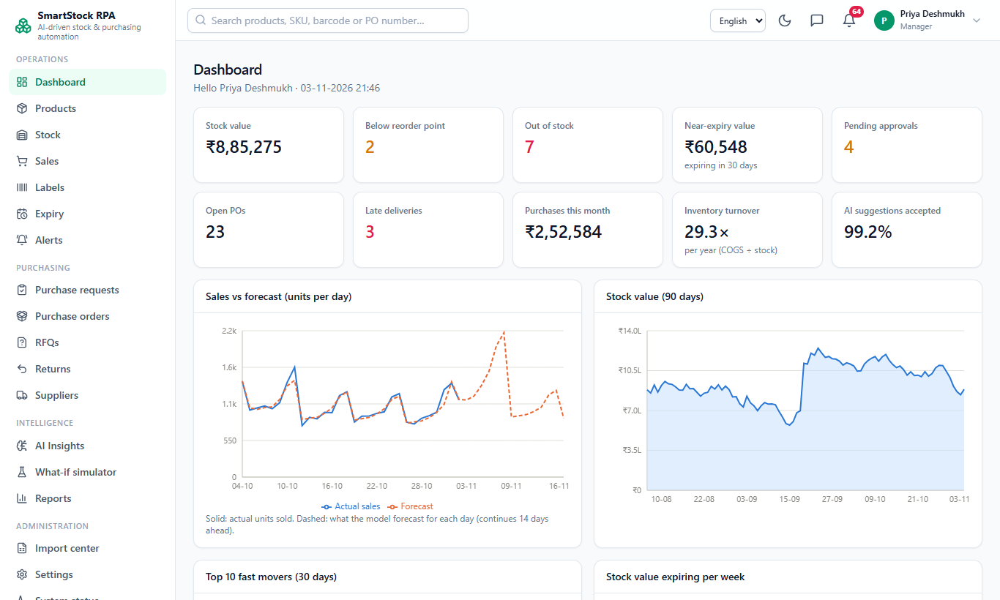
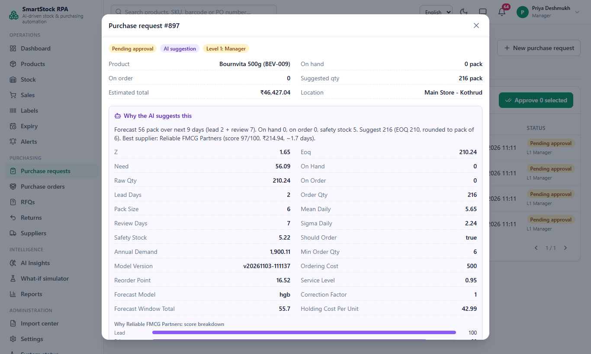
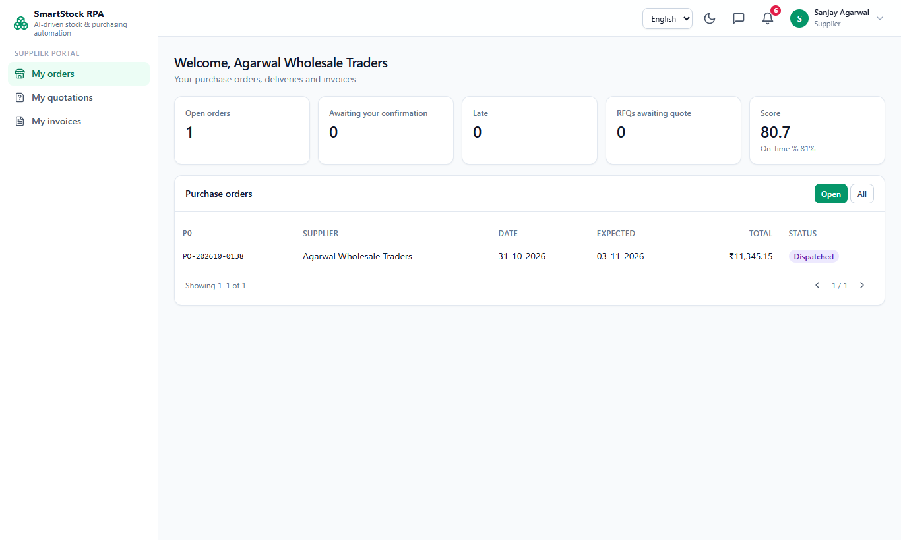
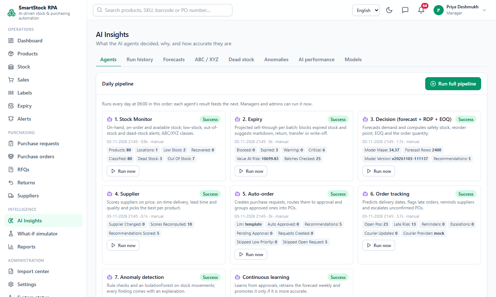
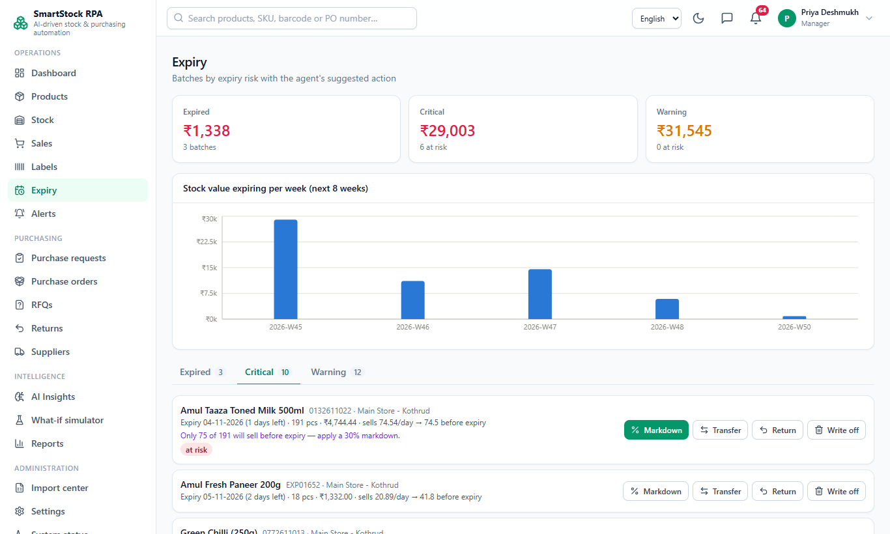
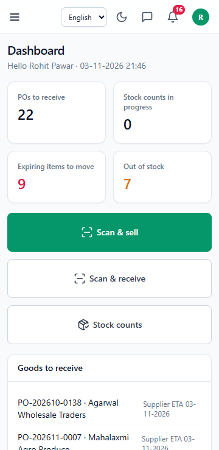
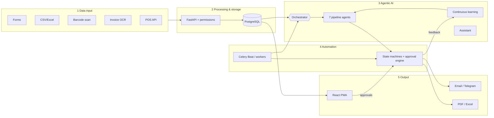

# SmartStock RPA

[](https://github.com/SB110604/smartstock-rpa/actions/workflows/ci.yml) [](LICENSE)   

**AI-driven Intelligent Robotic Process Automation for Adaptive Business Workflow Optimization** — a software-only
web application that runs stock and purchasing for a retail store with AI agents and an RPA workflow engine.

Product data, stock, sales and supplier data come in through forms, CSV/Excel import, invoice OCR, browser barcode
scanning and a POS API. Eight AI agents monitor stock and expiry, forecast demand, decide what and how much to buy,
pick the best supplier, raise purchase requests, track deliveries and detect anomalies; a chat assistant answers
questions. An RPA engine moves every purchase through approval → purchase order (PDF emailed) → supplier
confirmation/dispatch → goods receipt → 3-way match → close, with reminders and escalations on timers. Approver
decisions and new sales feed back into the models.

## Contents
[Features](#features) · [Screenshots](#screenshots) · [Architecture](#architecture) · [Tech stack](#tech-stack) ·
[Quick start (Docker)](#quick-start-docker) · [Demo logins](#demo-logins) · [Running without Docker](#running-without-docker) ·
[Tests](#tests) · [Evaluation](#evaluation) · [Environment variables](#environment-variables) ·
[Troubleshooting](#troubleshooting) · [Documentation](#documentation)

## Features

**Data input** — validated forms with search/filter/pagination; CSV/Excel import center (templates, auto column
mapping, per-row preview errors, error report) for products, suppliers, supplier prices, opening stock and sales
history; Code128 + QR label sheets; camera/USB barcode scanning on stock-in, stock-out, sales, counts and GRN;
supplier-bill OCR (Tesseract + RapidFuzz, per-line confidence, never auto-saves); POS sales API with API keys;
optional IMAP quotation reader.

**Inventory** — batches per location with expiry, FEFO picking, markdowns, write-offs, adjustments with reasons,
cycle counts with variance report, inter-location transfers, dead-stock detection, ABC/XYZ classes.

**AI agents** — Stock Monitor → Expiry → Decision (HistGradientBoosting forecast vs 28-day MA, safety stock, reorder
point, EOQ, perishable cap, learned correction) → Supplier (weighted score) → Auto-order → Tracking (predicted
delivery, reminders, escalation, courier) → Anomaly (5 rules + IsolationForest), plus Continuous learning and a chat
assistant. Every decision carries its full explanation. Run daily by Celery Beat or on demand.

**Workflow automation** — explicit state machines for purchase requests, POs, transfers, returns and RFQs; approval
rules (auto / manager / manager → admin), edit-and-approve, bulk approve, single-use email/Telegram approval links,
SLA reminders and escalation; GST-correct PO PDFs (CGST+SGST or IGST, HSN, amount in words); supplier portal;
partial GRNs with damaged-goods quarantine; 3-way match with tolerances; returns with debit notes; RFQs with quote
comparison.

**Output** — role-based dashboards with charts, alerts center, notifications (in-app, email, Telegram), AI
Insights and AI performance, what-if simulator, six reports with PDF/Excel export and scheduled emails, audit log
with diffs, backups. English / हिन्दी / मराठी, dark mode, responsive to 360 px, installable PWA.

## Screenshots

Captured from the seeded demo store with `npm run screenshots` (in `frontend/`).

| Dashboard | Purchase request with AI explanation | Supplier portal |
|---|---|---|
|  |  |  |
| **AI Insights** | **Expiry actions** | **Mobile (360 px)** |
|  |  |  |

## Architecture



Details, the purchase sequence diagram and the learning loop: [docs/ARCHITECTURE.md](docs/ARCHITECTURE.md).

## Tech stack

| Layer | Choice |
|---|---|
| Backend | Python 3.11, FastAPI, SQLAlchemy 2, Alembic, Pydantic v2 |
| Database / jobs | PostgreSQL 16, Celery + Redis, Celery Beat (Asia/Kolkata) |
| ML / OCR / documents | pandas, numpy, scikit-learn (HistGradientBoostingRegressor, IsolationForest), joblib; Tesseract + pdf2image, RapidFuzz; ReportLab, openpyxl, python-barcode, qrcode |
| LLM | provider abstraction `none` (default) / `ollama` / `anthropic` / `openai`; rule-based fallback everywhere |
| Frontend | React 18, Vite, TypeScript (strict), Tailwind, React Router, TanStack Query, Recharts, react-hook-form + zod, i18next, html5-qrcode |
| Tests | pytest + coverage, Vitest + Testing Library, Playwright |
| Deployment | Docker Compose: db, redis, api, worker, beat, web (nginx), mailpit |

## Quick start (Docker)

Requirements: Docker Desktop (Windows/macOS) or Docker Engine + Compose v2 (Linux), ~4 GB free RAM for Docker,
GNU Make (optional — every target is a one-line command you can copy from the `Makefile`).

```bash
cd smartstock-rpa              # the project folder (git clone of this repository, or the unzipped submission)
cp .env.example .env          # optional: works with defaults; change SECRET_KEY for anything public
make up                       # docker compose up --build -d  (first build takes a few minutes)
make seed                     # demo data + model training + first AI run (about 1–2 minutes)
```

Open:
- App: **http://localhost:5173**
- API docs (OpenAPI): http://localhost:8000/docs · health: http://localhost:8000/api/v1/health
- Mailpit (all outgoing email): **http://localhost:8025**

`make down` stops everything; data stays in Docker volumes. `make migrate` applies migrations (the api container
also runs them on start).

## Demo logins

| Role | Email | Password |
|---|---|---|
| Admin | admin@demo.in | Admin@123 |
| Manager | manager@demo.in | Manager@123 |
| Staff | staff@demo.in | Staff@123 |
| Supplier (Agarwal Wholesale Traders) | supplier1@demo.in | Supplier@123 |
| Supplier (Shah Distributors) | supplier2@demo.in | Supplier@123 |

`make seed` replaces all data with the deterministic demo store **Shree Ganesh SuperMart, Pune**: 2 locations,
8 categories, 80 products, 10 suppliers (Maharashtra and other states), 15 months of daily sales with weekly,
salary-week and festival patterns, 12 months of POs/GRNs/invoices (late deliveries, damaged goods, two 3-way
mismatches), batches in every expiry bucket, dead stock and injected anomalies. A guided walk-through and a
10-minute viva script are in [docs/USER_GUIDE.md](docs/USER_GUIDE.md).

## Running without Docker

Requirements: Python 3.11+, Node 20+, PostgreSQL 16, Redis 7; Tesseract + Poppler for OCR (optional).

```bash
# database (or use your own Postgres and set DATABASE_URL / TEST_DATABASE_URL)
scripts/dev-db.sh start                 # private cluster on :5433 with smartstock + smartstock_test databases
redis-server &                          # or a Redis service on :6379

cd backend
python -m venv .venv && . .venv/bin/activate      # Windows: .venv\Scripts\activate
pip install -r requirements-dev.txt
alembic upgrade head
python -m app.seed
uvicorn app.main:app --port 8000 &
celery -A app.tasks.celery_app worker -P solo --loglevel=INFO &   # -P solo on Windows
celery -A app.tasks.celery_app beat --loglevel=INFO &

cd ../frontend
npm ci
npm run dev                             # http://localhost:5173, proxies /api to :8000
```

Defaults in `app/core/config.py` match this layout (Postgres on 5433, Redis on 6379, SMTP on localhost:1025 — run
Mailpit locally or set `SMTP_*`). With `make`, append `LOCAL=1` to run backend targets in your venv, e.g.
`make test LOCAL=1`.

## Tests

```bash
make test        # backend pytest with coverage (in the api container) + frontend lint & Vitest (docker build --target test)
make lint        # ruff + ESLint
make e2e         # Playwright against the running stack at http://localhost:5173 (needs `npx playwright install chromium` once)
```

- Backend: 175+ tests on a real PostgreSQL test database (migrated with Alembic, each test rolled back): auth/2FA,
  permissions (staff/supplier 403s, supplier isolation), FEFO, SS/ROP/EOQ formulas, rounding and perishable cap,
  supplier score, GST split, approval routing, multi-level approval, token single-use and expiry, every invalid
  workflow transition, 3-way tolerance, CSV import validation, assistant intents, OCR parsing, learning/promotion,
  reports. Coverage on `services/`, `workflow/`, `agents/`, `ml/`: **90 %**.
- Frontend: Vitest component tests (login + 2FA, tables, approval link page, expiry actions, chat, simulator,
  translation parity).
- Playwright: full purchase cycle (manager runs the orchestrator → approves → PO → supplier confirms + dispatches →
  staff GRN → stock increases), 360 px layout check on 30 pages, PWA installability/offline.
  Set `E2E_BASE_URL` to test another URL and `PW_CHROMIUM_PATH` to reuse an installed Chromium. Without Docker,
  run the e2e tests against a production build so the PWA check can run (it is skipped on the Vite dev server):
  `cd frontend && npm run build && npm run preview` (http://localhost:4173, proxies /api), then
  `E2E_BASE_URL=http://localhost:4173 npm run e2e`.
- `npm run screenshots` (in `frontend/`, against a seeded stack) regenerates the README screenshots in `docs/screenshots/`.

## Evaluation

`make eval` back-tests the last 90 days of the seeded data and writes **[reports/evaluation.md](reports/evaluation.md)**
with three charts. Latest run:

| | Baseline | SmartStock |
|---|---:|---:|
| Forecast MAPE (7-day ahead) | 40.3 % (28-day MA) | **35.2 %** |
| Stock-out product-days | 819 | **210** |
| Fill rate | 84.5 % | **94.9 %** |
| Expired stock value | ₹10.5 L | **₹0.85 L** |
| Average inventory value | **₹5.5 L** | ₹14.3 L |
| Purchase orders | 504 | **364** |
| On-time delivery | 61.2 % | **85.7 %** |
| Manual purchasing time saved | — | **≈ 79 h** |

SmartStock holds more stock because EOQ with the default ₹500 ordering cost favours fewer, larger orders — see the
report's discussion and try lower ordering costs in the what-if simulator.

## Environment variables

All configuration is read from the environment (`.env` is loaded if present). Every feature works with the
defaults; integrations switch on when their variables are set.

| Variable | Default | Purpose |
|---|---|---|
| `APP_ENV` | development | `production` refuses to start with the default `SECRET_KEY` |
| `SECRET_KEY` | change-me… | JWT signing key — set a long random value |
| `TZ` | Asia/Kolkata | business time zone |
| `FRONTEND_URL` / `CORS_ORIGINS` | http://localhost:5173 | links in emails / allowed browser origin |
| `LOG_LEVEL` | INFO | JSON logs to stdout |
| `POSTGRES_USER` / `POSTGRES_PASSWORD` / `POSTGRES_DB` | smartstock | database container credentials |
| `DATABASE_URL` / `TEST_DATABASE_URL` | postgresql+psycopg://… | app and test databases |
| `REDIS_URL` | redis://redis:6379/0 | Celery broker, rate limiting, heartbeat |
| `ACCESS_TOKEN_MINUTES` / `REFRESH_TOKEN_DAYS` | 30 / 7 | token lifetimes |
| `LOGIN_RATE_LIMIT_PER_MINUTE` | 10 | per IP + email |
| `STORAGE_DIR` | /data | PDFs, uploaded invoices, model files |
| `BACKUP_DIR` / `BACKUP_KEEP` | /backups / 14 | nightly `pg_dump` archives |
| `SMTP_HOST` `SMTP_PORT` `SMTP_USER` `SMTP_PASSWORD` `SMTP_TLS` `SMTP_FROM` | mailpit:1025 | outgoing email |
| `EMAIL_ASYNC` | true | send emails from the Celery worker (inline fallback) |
| `TELEGRAM_BOT_TOKEN` | — | enables Telegram alerts and approval links (users add their chat ID in Profile) |
| `LLM_PROVIDER` | none | `none` · `ollama` · `anthropic` · `openai` |
| `LLM_TIMEOUT_SECONDS` | 30 | per LLM call |
| `OLLAMA_BASE_URL` / `OLLAMA_MODEL` | http://host.docker.internal:11434 / llama3.1:8b | local LLM |
| `ANTHROPIC_API_KEY` / `ANTHROPIC_MODEL` | — | optional hosted LLM |
| `OPENAI_API_KEY` / `OPENAI_MODEL` / `OPENAI_BASE_URL` | — / gpt-4o-mini | OpenAI-compatible API |
| `IMAP_HOST` `IMAP_PORT` `IMAP_USER` `IMAP_PASSWORD` `IMAP_FOLDER` | — | email quotation reader (hidden when unset) |
| `TESSERACT_CMD` | tesseract | OCR binary |
| `COURIER_PROVIDER` | mock | courier tracking: `mock` (simulated) or `shiprocket` |
| `SHIPROCKET_EMAIL` / `SHIPROCKET_PASSWORD` | — | Shiprocket API user; tracking by the PO's AWB, falls back to simulated status |
| `SHIPROCKET_BASE_URL` | https://apiv2.shiprocket.in/v1/external | Shiprocket API base |
| `VITE_API_BASE` | /api/v1 | frontend build-time API base |

Development-only: `PG_BIN` (PostgreSQL binaries for `scripts/dev-db.sh` and backups), `DEV_DB_PORT` (5433),
`E2E_BASE_URL`, `PW_CHROMIUM_PATH`.

## Troubleshooting

- **Windows line endings** — the repo forces LF via `.gitattributes`. If you cloned before that, run
  `git config core.autocrlf false && git rm --cached -r . && git reset --hard`. CRLF in shell scripts breaks containers.
- **Docker Desktop memory** — give Docker at least 4 GB (Settings → Resources); the first `make seed` trains models.
- **Ports in use** — 5173 (web), 8000 (api), 5432 (Postgres), 8025/1025 (Mailpit). Stop the other program or change
  the left side of the port mappings in `docker-compose.yml`.
- **No `make` on Windows** — use Git Bash with `choco install make`, or run the commands from the `Makefile` directly
  (e.g. `docker compose exec -T api python -m app.seed`).
- **Camera does not start** — browsers only allow the camera on `https://` or `localhost`; on a phone use the
  computer's HTTPS address (or type/scan with a USB scanner). The manual SKU box always works.
- **Emails not visible** — open Mailpit at http://localhost:8025; check `docker compose logs worker`.
- **OCR says unavailable** — Tesseract is installed in the Docker image; for local runs install it
  (`apt install tesseract-ocr poppler-utils`, `brew install tesseract poppler`, or the UB Mannheim installer on
  Windows) and set `TESSERACT_CMD`.
- **"Need at least 88 days of sales history"** — run `make seed` (or import sales history) before training.
- **Health shows worker/beat "down"** — the API works without them; start the worker/beat containers or processes.

## Documentation

- [SETUP_GUIDE.md](SETUP_GUIDE.md) — installation prerequisites and how to run on a new computer
- [docs/PROJECT_SPEC.md](docs/PROJECT_SPEC.md) — the specification
- [docs/ARCHITECTURE.md](docs/ARCHITECTURE.md) — layers, agents, sequence and deployment diagrams
- [docs/USER_GUIDE.md](docs/USER_GUIDE.md) — how each role works + 10-minute viva demo script
- [docs/API.md](docs/API.md) — endpoint summary (OpenAPI at `/docs`)
- [docs/DECISIONS.md](docs/DECISIONS.md) — design decisions not covered by the spec
- [docs/PROGRESS.md](docs/PROGRESS.md) — build log per phase

## License

[MIT](LICENSE) © 2026 Sahil Bodke
