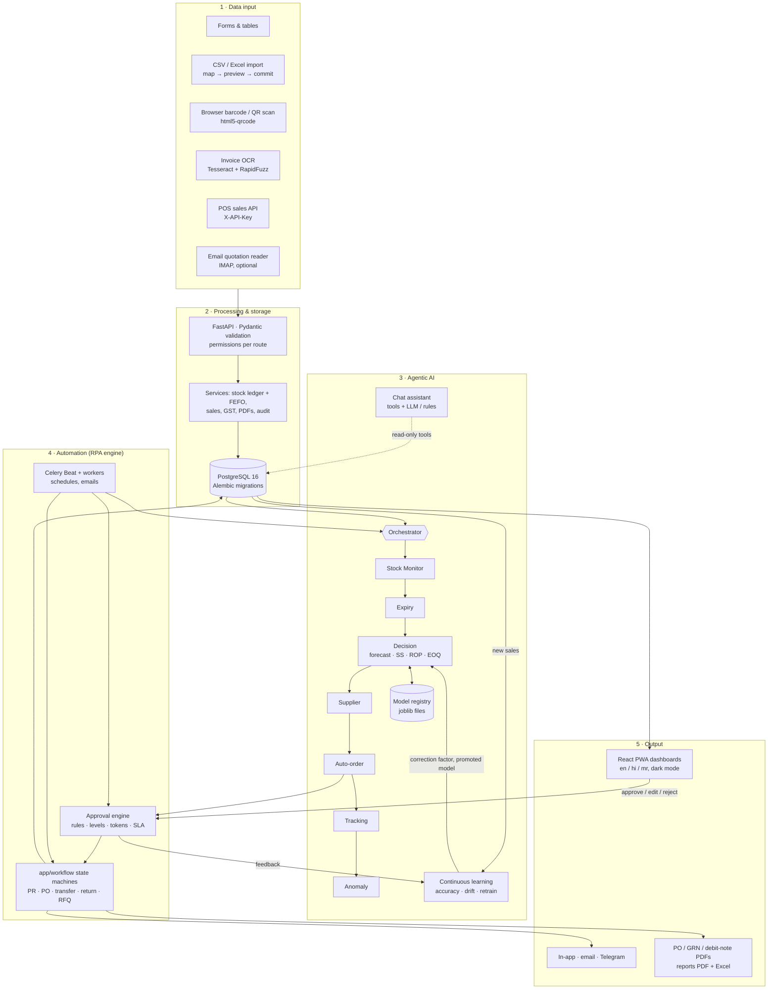
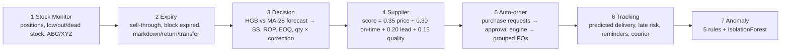
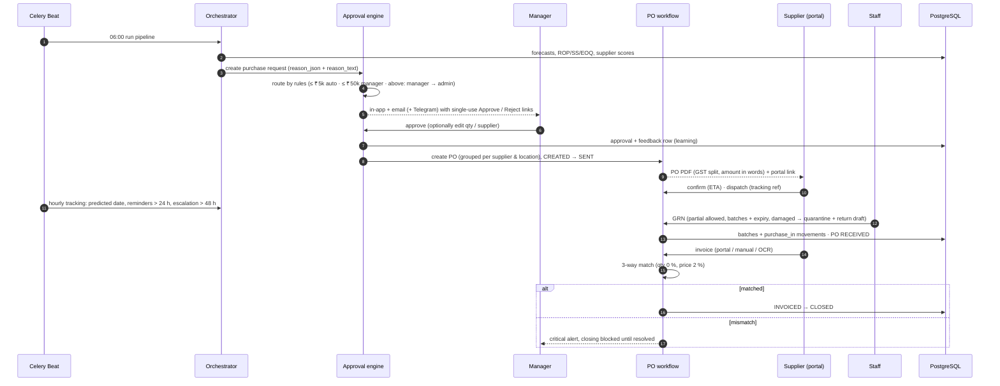
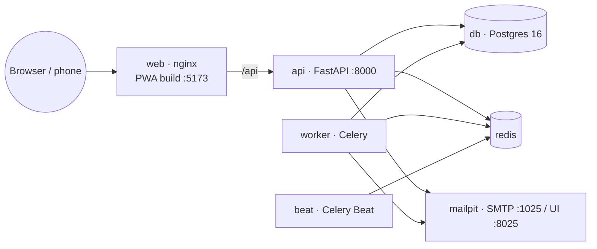

# SmartStock RPA — Architecture

SmartStock RPA is organised in the five layers used in the project report, with a continuous-learning loop feeding
the AI layer back from the automation and output layers.

## Layer by layer

| Layer | What happens | Main code |
|---|---|---|
| 1 Data input | Forms with zod + Pydantic validation; CSV/XLSX import with auto column mapping, per-row errors and error report; barcode/QR scanning (camera, USB scanner or typed); OCR of supplier bills into a pre-filled invoice; POS sales API; IMAP price-update reader | `frontend/src/pages/*`, `app/services/imports.py`, `app/services/ocr.py`, `app/api/v1/operations.py`, `app/services/quote_reader.py` |
| 2 Processing & storage | REST API under `/api/v1`, permission dependency on every route, service layer writes the stock ledger (batch + signed movement), audit rows with before/after diffs, document numbering, GST split | `app/api/v1`, `app/services`, `app/models`, `alembic/` |
| 3 Agentic AI | Seven pipeline agents run in a fixed order and pass results along; the learning agent and the assistant sit beside them; every run is logged in `agent_runs` | `app/agents`, `app/ml`, `app/assistant`, `app/llm` |
| 4 Automation | Explicit state machines; every transition validates the move (409 otherwise), writes status history + audit + notifications; approval routing by rules; one-click tokens; Celery Beat schedules | `app/workflow`, `app/tasks` |
| 5 Output | Role dashboards, alerts center, AI insights, reports (PDF/Excel/email), PDFs for POs, GRNs and debit notes, notifications | `frontend/src`, `app/services/{dashboard,reports,documents,notify}.py` |

## Agents and the daily pipeline

Each agent is a class with `run(context) -> AgentResult`; `app/agents/base.execute` runs it in its own transaction,
records `agent_runs`, and catches failures so the next agent still runs. Schedules (Asia/Kolkata): pipeline 06:00,
stock + expiry every 2 h 08:00–22:00, tracking hourly, supplier scores 02:00, learning (accuracy/drift) 05:45,
ABC/XYZ + anomaly model + forecast retraining Sunday 03:00.

## Purchase flow (sequence)

## State machines (`app/workflow/machines.py`)

| Entity | States |
|---|---|
| Purchase request | DRAFT → PENDING_APPROVAL → APPROVED / REJECTED → ORDERED (+ CANCELLED) |
| Purchase order | CREATED → SENT → CONFIRMED → DISPATCHED → PARTIALLY_RECEIVED → RECEIVED → INVOICED → CLOSED (+ REJECTED_BY_SUPPLIER, CANCELLED) |
| Stock transfer | REQUESTED → APPROVED → DISPATCHED → RECEIVED (+ CANCELLED) |
| Supplier return | DRAFT → PENDING_APPROVAL → APPROVED → DISPATCHED → CREDIT_RECEIVED (+ REJECTED, CANCELLED) |
| RFQ | OPEN → CLOSED → AWARDED (+ CANCELLED) |

## Continuous learning loop

1. Every final approval decision writes `feedback` (approved / edited / rejected).
2. Per product, the correction factor is an EMA (α = 0.3) of final ÷ suggested quantity, clamped to [0.5, 1.5], and
   multiplies the next order quantity.
3. Three rejections in a row lower the product's priority (auto-order then waits until it is actually out of stock)
   and raise an info alert.
4. Daily, the learning agent stores realised MAPE of yesterday's forecast; a rolling 14-day MAPE above 1.5 × the
   training MAPE raises a `forecast_drift` alert.
5. Weekly, a challenger model is trained and compared with the incumbent on the same 28-day holdout; it is promoted
   only if its MAPE is lower. Every version is in `model_registry`.

## Deployment

`docker compose up --build` starts all seven services with health checks; the api container runs `alembic upgrade head`
before serving. Secrets come only from environment variables (`.env.example` documents every one). LLM, Telegram,
IMAP and courier integrations are optional and each has a working fallback.

## Security

JWT access (30 min) + refresh (7 days) tokens revoked through a per-user `token_version`; bcrypt; optional TOTP for
admins; login and forgot-password rate limits; permission checked on every route from one matrix
(`app/core/permissions.py`); suppliers see only their own POs/RFQs/invoices; CORS limited to the frontend origin;
security headers; errors never include stack traces; every create/update/delete/transition is in the audit log with
before/after values and client IP; one-click approval tokens are hashed, single-use and expire after 48 h.
