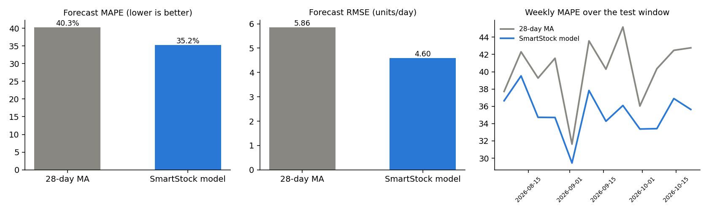
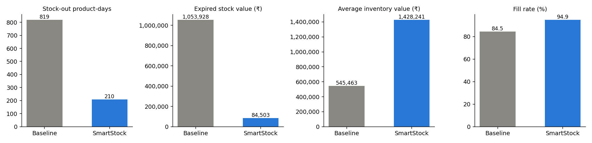
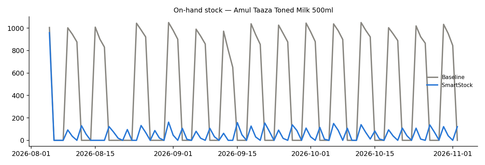

# SmartStock RPA — Evaluation

Generated by `make eval` on 03-11-2026 from the seeded demo data (Shree Ganesh SuperMart).
Test window: **05-08-2026 to 02-11-2026** (90 days, 80 products). All models were trained only on data before the window.

## 1. Forecast accuracy

Seven-day-ahead forecasts from a weekly rolling origin (12 origins × 80 products).

| Metric | 28-day moving average | SmartStock model (HistGradientBoosting) | Change |
|---|---:|---:|---:|
| MAPE | 40.3% | 35.2% | -12.5% ✔ |
| RMSE (units/day) | 5.86 | 4.60 | -21.5% ✔ |
| WAPE | 26.7% | 22.2% | -16.7% ✔ |

MAPE is averaged over products and ignores days with zero sales (undefined); WAPE weights errors by volume.

## 2. Inventory policy simulation

| Metric | Baseline policy | SmartStock policy | Change |
|---|---:|---:|---:|
| Stock-out days (product-days) | 819 | 210 | -74.4% ✔ |
| Fill rate | 84.5% | 94.9% | +12.3% ✔ |
| Expired / wasted stock value | ₹1,053,928 | ₹84,503 | -92.0% ✔ |
| Markdown cost (price given away) | ₹0 | ₹32,527 | — |
| Average inventory value | ₹545,463 | ₹1,428,241 | +161.8% |
| Number of purchase orders | 504 | 364 | -27.8% ✔ |
| Total purchase cost | ₹6,441,864 | ₹7,443,356 | +15.5% |
| Purchase cost per unit sold | ₹78.77 | ₹81.08 | +2.9% |
| On-time delivery | 61.2% | 85.7% | +40.0% ✔ |
| Manual purchasing time | 126.0 h (15 min × PO) | 12.1 h (2 min × PO, approval only) | 78.9 h saved |

## 3. Reading the results

- SmartStock trades **more stock on the shelf** for **far fewer stock-outs and much less expiry waste**: the spec's EOQ with an ordering cost of ₹500 per order favours fewer, larger orders for cheap fast movers, which raises average inventory value. Lowering `ordering_cost_S` in Settings (or raising `holding_cost_pct`) shrinks order sizes; the What-if simulator shows the effect before changing anything.
- Purchase cost is higher partly because SmartStock sells more (higher fill rate) and ends the window holding more stock; compare *purchase cost per unit sold*.
- Waste falls mainly because of FEFO picking, the shelf-life cap on perishable orders and markdowns on near-expiry batches.

## 4. Method and assumptions

- **Baseline policy**: reorder level = 7 days of average sales, order quantity = 14 days of average sales (averages from the 90 days before the window), cheapest supplier, no FEFO (shoppers take the freshest batch), no markdowns.
- **SmartStock policy**: the 7-agent logic — weekly re-forecast, safety stock z·σ·√L, reorder point d̄·L + SS, EOQ √(2DS/H), order quantity max(EOQ, ROP + d̄·review − position) with the perishable cap and pack rounding, best-scored supplier (price/on-time/lead/quality weights from settings), FEFO picking, and a 30 % markdown on critical-expiry batches that would not sell in time (assumed demand lift 60%).
- Both policies start with 14 days of stock and draw each delivery's delay from that supplier's real delay history before the window, so late suppliers are late in the simulation too. One order in flight per product.
- Manual time saved assumes 15 min per manually prepared PO versus 2 min to review an AI-prepared one.
- Demand is the store's real daily unit sales; lost sales are not back-ordered.

_Runtime 15 s._
